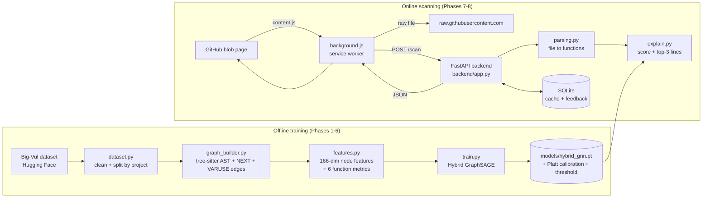

# GNN-Based Vulnerability Scanner for C/C++ on GitHub

A scanner that reads C/C++ code on GitHub, turns every function into a **graph**,
and uses a **Hybrid GraphSAGE** neural network (trained from scratch) to predict a
bug-risk score per function. It highlights the riskiest lines with a short
plain-English reason, right inside the GitHub page, through a Chrome extension.

> **Results in brief:** on a project-disjoint Big-Vul test set the Hybrid GraphSAGE
> reaches **PR-AUC 0.208** (95% CI 0.164–0.267; **0.222 ± 0.011** over 5 seeds),
> significantly better than rule-based and text-based baselines (≤ 0.108). But
> **function length alone reaches 0.223**: on this data the model mostly learns that
> long functions are riskier, and the graph adds no measurable gain beyond size
> (Section 7.4). Its line pointer finds a real fix line 21% of the time (random: 9%).

---

## 1. Problem

Rule-based static analyzers (regex/pattern tools such as Flawfinder) **miss
structural bugs** and raise **many false alarms**. Machine-learning tools that
treat code as **plain text** throw away its **tree structure** and the **order in
which it runs**.

This project keeps that structure:

1. Split each source file into functions.
2. Turn each function into a graph: its **Abstract Syntax Tree (AST)** plus two
   simple extra edge types (statement order and variable reuse).
3. A **Hybrid GraphSAGE** GNN predicts a bug-risk probability per function.
   *Hybrid* means the learned graph embedding is concatenated with 6 hand-crafted
   code metrics before the final classifier.
4. Explain the score: rank lines by **attention × gradient saliency**, return the
   top 3 lines with a template reason.
5. Show it on GitHub through a Chrome extension talking to a local FastAPI server.

---

## 2. Architecture



**Inside the model** (`src/model.py`):

```
node features (166) ─► SAGEConv ─► SAGEConv ─► SAGEConv ─► node vectors h (128)
                        (each: ReLU + dropout 0.3)

h ─► attention pool (linear score → softmax → weighted sum) ┐
  └► mean pool ─────────────────────────────────────────────┤► graph embedding (256)
                                                            │
graph embedding ‖ 6 metrics (262) ─► MLP 128 ─► 64 ─► 1 ─► Platt-calibrated sigmoid
```

---

## 3. Folder structure

```
Project/
├── data/                 # raw + processed data, cached graphs (gitignored)
├── src/
│   ├── dataset.py          # Phase 1: download, clean, split by project
│   ├── evaluate.py         # shared metrics: P/R/F1, PR-AUC, P@Top-10%
│   ├── parsing.py          # tree-sitter: file → functions → AST
│   ├── graph_builder.py    # AST + extra edges → PyG Data
│   ├── build_graphs.py     # Phase 3 runner: cache all graphs
│   ├── features.py         # node features + function metrics
│   ├── prepare_features.py # Phase 4 runner: vocab, metric stats
│   ├── gnn_data.py         # loading graphs for training
│   ├── model.py            # Hybrid GraphSAGE
│   ├── train.py            # training, calibration, ablations
│   ├── calibration.py      # Platt scaling + calibration error (ECE)
│   ├── calibrate_saved.py  # re-calibrate an already-trained model (no retraining)
│   ├── run_seeds.py        # main model + ablations over 5 seeds
│   ├── analysis.py         # EDA, size baselines, length bands, bootstrap CIs, plots
│   ├── explain.py          # importance → line scores → reasons
│   ├── cwe.py              # stretch goal: CWE classes + labels
│   └── train_cwe.py        # stretch goal: CWE-type head training/eval
├── baselines/
│   └── run_baselines.py    # Flawfinder, TF-IDF + LogReg, risky-API rule
├── backend/
│   ├── app.py              # FastAPI server (/scan, /feedback, /health)
│   └── sample.c            # small file for testing the API
├── extension/              # Chrome extension (Manifest V3, plain JS)
├── docs/                   # project report + illustrated explainer, with their sources
│   ├── GNN_Vulnerability_Scanner_Report.docx / .pdf   # rebuild: python docs/build_report.py
│   ├── GNN_Vulnerability_Scanner_Explained.pdf        # rebuild: python docs/build_pdf.py
│   ├── build_report.py, report_content.py, report_diagrams.py
│   ├── build_pdf.py, project_explained.html
│   └── assets/              # report template, screenshot, figures
├── results/                # analysis.json, seed_runs.json, original training log
├── models/                 # saved weights + vocab + metric stats (gitignored)
├── notebooks/              # optional EDA
├── requirements.txt
└── README.md
```

---

## 4. Setup

Needs **Python 3.10+** (built and tested on 3.13, Windows 11). Runs on a normal
laptop (CPU, 8-16 GB RAM); a GPU is optional.

```powershell
cd C:\path\to\Project
python -m venv .venv
.venv\Scripts\activate
pip install -r requirements.txt
```

A plain `pip install torch` gives the CPU build, which is enough for everything.

---

## 5. Reproduce the pipeline

Run these **from the project root**, in order. Each step caches its output, so you
only run it once.

| Step | Command | What it does | Time* |
|---|---|---|---|
| 1. Data | `python src/dataset.py --subset 30000` | Download Big-Vul, clean, split by project | ~1-3 min (first download) |
| 2. Baselines | `python baselines/run_baselines.py` | Score the 3 baselines on test | ~1 min |
| 3. Graphs | `python src/build_graphs.py` | Build + cache 30k graphs | ~15 s |
| 4. Features | `python src/prepare_features.py` | Type vocab, metric stats, metric vectors | ~30 s |
| 5. Train | `python src/train.py` | Main model + 3 ablations + final table (Platt-calibrated) | ~5 min GPU; longer on CPU |
| 6. Explain | `python src/explain.py` | Demo explanation + Top-3 line hit rate | ~30 s |
| 7. Seeds | `python src/run_seeds.py` | Main model + ablations over 5 seeds → `results/seed_runs.json` | ~20 min GPU |
| 8. Analysis | `python src/analysis.py` | EDA, size baselines, length bands, bootstrap CIs, calibration and learning-curve plots → `results/analysis.json` | ~3 min |

A model trained **before** the calibration fix only had temperature scaling; run
`python src/calibrate_saved.py` once to give it Platt calibration without retraining.

\* Rough times on the development laptop (the training run used its GPU at about
3-8 s per epoch). On a CPU-only or low-RAM machine, train
faster with fewer graphs: `python src/train.py --max-train 6000 --epochs 15`
(add `--skip-ablations` to train only the main model).

Useful quick checks:

```powershell
python src/graph_builder.py     # prints one tiny example graph to check by eye
python src/parsing.py           # splits a small sample file into functions
```

---

## 6. Run the scanner

### 6.1 Backend

From the **project root**:

```powershell
python -m uvicorn backend.app:app --port 8000
```

Wait for `Model loaded. Ready to scan on CPU.` and `Application startup complete`.
Test it:

```powershell
$code = [System.IO.File]::ReadAllText("backend/sample.c")
$body = @{ filename = "sample.c"; code = $code } | ConvertTo-Json
Invoke-RestMethod -Uri http://127.0.0.1:8000/scan -Method Post -Body $body -ContentType "application/json"
```

**API**

| Endpoint | Body | Returns |
|---|---|---|
| `POST /scan` | `{filename, code}` | `{file_hash, functions: [{name, start_line, end_line, risk_score, band, top_lines: [{line, reason, text}]}], scan_time_ms, cached}`. `top_lines` is ranked: index 0 is the most likely vulnerable line. |
| `POST /feedback` | `{file_hash, function_name, line, is_false_positive}` | `{status: "recorded"}` |
| `GET /health` | none | `{status, model_loaded}` |

Results are cached in `backend/cache.db` (SQLite), keyed by `SCANNER_VERSION` +
SHA-256 of the file, so the same file is never scanned twice.

### 6.2 Chrome extension

1. Open `chrome://extensions` and turn on **Developer mode**.
2. Click **Load unpacked** and select the `extension/` folder.
3. Open any C/C++ file on GitHub, for example
   `https://github.com/git/git/blob/master/usage.c`.

You will see:
- a **risk-% badge** at each function's first line (green / yellow / red by band),
- each function's **most likely vulnerable line** in strong red with an inline
  callout, e.g. `⚠ Likely vulnerable line · memcpy with a size not checked…`;
  its #2 and #3 suspicious lines get a lighter tint,
- a **hover card** on any marked line: which line it is, its rank, the reason,
  the function's risk, and a **👎 Not a bug** button (sent to `/feedback`),
- a collapsible **side panel** (bottom-right) that names the single **most likely
  vulnerable line in the file** with its code, then lists every function by risk
  with its suspicious lines; click a line to jump to it,
- a **popup** (toolbar icon) with the same top line and the 5 riskiest functions,
  also clickable.

### 6.3 Troubleshooting

| Symptom | Cause / fix |
|---|---|
| `ModuleNotFoundError: No module named 'backend'` | You started uvicorn inside `backend/`. Run it from the project root, or use `python -m uvicorn app:app --port 8000` inside `backend/`. |
| `[Errno 10048] ... only one usage of each socket address` | Another server already uses port 8000. Stop it first. |
| Banner: "Backend not reachable at http://127.0.0.1:8000" | Start the backend. The extension uses `127.0.0.1`, not `localhost`, because Chrome may send `localhost` to IPv6 `::1` while uvicorn only listens on IPv4. |
| Banner: "no functions found in this file" | Normal for files with only declarations/tables (e.g. `ctype.c`). |
| Code changes don't show up | Restart uvicorn (it doesn't auto-reload) and click ↻ on the extension card. Bump `SCANNER_VERSION` in `backend/app.py` when parsing/model code changes, so old cached results are ignored. |
| Highlights stop working after a GitHub redesign | Fix `getCodeCell()` in `extension/content.js`. It is the only function that depends on GitHub's HTML. |

---

## 7. Results

### 7.1 Dataset (Phase 1)

Big-Vul (`bstee615/bigvul` on Hugging Face): **217,007** functions →
**213,407** after the 3-500 line filter → **160,888** after whitespace-insensitive
de-duplication → class-balanced subset of **30,000**.

| Split | Functions | Vulnerable | Projects |
|---|---|---|---|
| train | 24,000 | 1,222 (5.1%) | 98 |
| val | 3,000 | 172 (5.7%) | 96 |
| test | 3,000 | 193 (6.4%) | 96 |

Splits are **project-disjoint** (no project appears in two splits). A greedy packer
assigns whole projects so function counts still come out at 80/10/10.

**EDA highlights** (full figures in the report, numbers in `results/analysis.json`):
- No missing or empty code. Missing values exist only in metadata: CWE ID 41,709,
  CVE ID 15,655, commit message 23,348.
- 53,371 duplicate rows. **916 groups of identical functions carry *both* labels**
  (2,307 rows). Deduplication kept the first copy's label, which adds some label noise.
- Vulnerable functions are much longer: median **30 vs 14 lines**. The gap is
  largest in test (**79 vs 22**).
- Train is dominated by **Chrome (50.1%)** and Linux (31.6%). Validation and test are
  each 96 mostly small projects (median 10 functions). 162 of 290 projects contain
  no vulnerable function at all.
- The six metrics are strongly correlated with length (Spearman 0.63–0.86) but only
  weakly with the label (≤ 0.14).
- One project name appears in two splits with different capitalisation
  (`varnish-cache` / `Varnish-Cache`, 17 functions, none vulnerable). The effect is
  negligible; project names should be lower-cased in future runs.

Top CWEs: CWE-119 (4,208), CWE-20 (3,193), CWE-399 (2,311), CWE-264 (1,989),
CWE-416 (1,502), CWE-200 (1,416), CWE-125 (1,219), CWE-189 (1,107), CWE-362 (979).

### 7.2 Graphs and features (Phases 3-4)

| Split | Avg nodes | Avg undirected edges | Build failures |
|---|---|---|---|
| train | 119.9 | 146.1 | 0 |
| val | 172.2 | 217.8 | 0 |
| test | 245.4 | 313.6 | 0 |

Node features: **166** = 101 (one-hot of top-100 AST types + "other") + 64 (hashed
token) + 1 (risky-API flag). Metric means, vulnerable vs safe (train):

| Metric | Vulnerable | Safe | Ratio |
|---|---|---|---|
| lines of code | 49.35 | 23.96 | 2.06× |
| cyclomatic complexity | 9.31 | 4.76 | 1.96× |
| pointer operations | 25.77 | 11.38 | 2.26× |
| risky API calls | 0.24 | 0.07 | 3.29× |
| max nesting depth | 2.27 | 1.71 | 1.33× |
| parameters | 2.15 | 1.70 | 1.27× |

These are means, which large functions pull upward. All of these metrics rise with
function length (Section 7.1), so the ratios mostly reflect that vulnerable
functions are longer.

### 7.3 Function-level detection (Phases 2 and 5, test set)

A random ranker scores PR-AUC ≈ 0.064 (the vulnerable rate). PR-AUC is average
precision (scikit-learn). Brackets are 95% bootstrap confidence intervals over
2,000 resamples of the test set. The two size baselines were added after a review
of the first version.

| Method | PR-AUC [95% CI] | P@Top-10% [95% CI] | Precision | Recall | F1 |
|---|---|---|---|---|---|
| Flawfinder (level ≥ 2) | 0.083 [0.067–0.107] | 0.116 [0.087–0.147] | 0.116 | 0.254 | 0.159 |
| Risky-API rule | 0.108 [0.081–0.149] | 0.132 [0.092–0.171] | 0.125 | 0.218 | 0.158 |
| TF-IDF + Logistic Regression | 0.103 [0.085–0.129] | 0.123 [0.087–0.160] | 0.108 | 0.456 | 0.174 |
| Lines of code only | **0.223** [0.177–0.285] | **0.234** [0.187–0.283] | – | – | – |
| 6 metrics only (LogReg) | 0.197 [0.158–0.252] | 0.217 [0.167–0.263] | – | – | – |
| **Hybrid GraphSAGE (ours)** | 0.208 [0.164–0.267] | 0.203 [0.160–0.253] | 0.219 | 0.306 | 0.255 |

**How to read it** (paired bootstrap tests):
- The model is **significantly better** than TF-IDF (AP difference +0.065 to +0.152)
  and the risky-API rule (+0.057 to +0.146).
- It is **not** better than the size baselines.
  - Against lines of code, the AP difference is −0.035 to +0.006. Lines of code is
    significantly better on P@Top-10% (−0.050 to −0.007).
  - Against the metrics regression, the AP difference is −0.007 to +0.029.
- **Correction to the first version:** P@Top-10% for Flawfinder was reported as 0.023
  ("below random"). That came from breaking tied scores by row order. With
  tie-aware counting (expected value under random tie-breaking) it is **0.116**.

Confusion matrix at the decision threshold: TN 2,596 · FP 211 · FN 134 · TP 59.
The model flags 270 functions (9%) and catches 59 of 193. 21.9% of flagged
functions are real vulnerabilities, 3.4× the base rate.

Training settings: Adam (lr 1e-3), batch 64, BCE with `pos_weight` = #safe/#vuln
(18.64), early stopping on validation PR-AUC (patience 6). The hyperparameters
were fixed in advance, not tuned.

### 7.4 Is the model more than a length detector?

AP inside four equal-size length bands of the test set:

| Lines | Functions | Vulnerable | Model | Lines-only | Metrics LogReg |
|---|---|---|---|---|---|
| 4–11 | 673 | 8 | 0.025 | 0.033 | 0.026 |
| 11–23 | 799 | 25 | 0.040 | 0.040 | 0.049 |
| 23–55 | 771 | 44 | 0.070 | 0.091 | 0.081 |
| 55–500 | 757 | 116 | 0.278 | 0.296 | 0.252 |

Inside every band the model is no better than the length baseline. Its score has a
**Spearman correlation of 0.87 with function length**. On this dataset and split the
model mostly learned that long functions are riskier; we could not show any gain
from the graph beyond size. Big-Vul itself contributes to this, since fixes tend to
touch large functions.

### 7.5 Calibration

The weighted loss (`pos_weight` 18.64) shifts the raw scores up by about ln 18.6 ≈ 2.9.
Temperature scaling (the first version) can only stretch or squash scores, not shift
them. It pushed every test probability into **0.405–0.643** (mean 0.510, against a
true rate of 0.064), so all 3,000 functions fell in "Medium".

**Platt scaling** σ(a·z + b) is fitted on validation (a = 0.769, b = −3.071 ≈ −ln 18.6).
Results:
- Mean probability **0.065**; expected calibration error **0.446 → 0.014**.
- Ranking, PR-AUC and the flagged functions are all unchanged.
- The decision threshold is 0.116 in calibrated units.

Bands are anchored to the threshold:
- **Low:** below the threshold
- **Medium:** flagged
- **High:** at least 2× the threshold

On test that gives 2,730 Low, 212 Medium and 58 High.

### 7.6 Ablations over 5 seeds

| Variant | Test PR-AUC | Test P@Top-10% | Val PR-AUC | First single run |
|---|---|---|---|---|
| **Hybrid GraphSAGE (main)** | **0.222 ± 0.011** | 0.223 ± 0.013 | 0.130 | 0.208 |
| AST edges only | 0.218 ± 0.017 | 0.219 ± 0.017 | 0.131 | 0.228 |
| GCN instead of SAGE | 0.219 ± 0.011 | 0.217 ± 0.014 | 0.133 | 0.194 |
| No metrics (pure GNN) | 0.127 ± 0.005 | 0.147 ± 0.011 | 0.086 | 0.133 |

- **The metrics are the one clear effect.** Removing them gives 0.222 → 0.127; they
  carry the size signal.
- **AST-only vs all edges is a tie.** AST-only won in 2 of 5 seeds. The first run's
  0.228 vs 0.208 was seed luck. Our SAGEConv layers ignore edge types, so the extra
  edges enter as untyped neighbours.
- **SAGE vs GCN is a tie** (0.222 vs 0.219).
- **Validation PR-AUC peaks within 1–3 epochs**, then falls as the model over-fits.
  Validation (≈0.13) is lower than test (≈0.21) because the splits differ; the
  untrained length baseline shows the same gap (0.130 vs 0.223).

### 7.7 Line-level explanations (Phase 6)

Node importance = **attention weight × gradient-saliency magnitude**, summed per
source line. The top 3 lines are returned, ranked; the #1 line is what the
extension labels "Likely vulnerable line". Each comes with a template reason
(strcpy/strcat, memcpy, use-after-free, malloc without a NULL check, else
"unusual structure").

Two rules decide which nodes vote for a line:
- **Single-line nodes only.** Multi-line "container" nodes (the whole function, a
  `{ }` body) describe a block, not a line; otherwise all their importance lands on
  their first line, usually the signature.
- **Body lines only.** The signature (return type, name, parameters) is crowded
  with small nodes but is a declaration, not where a bug happens.

Then, **pattern first**: within the top 3, a line matching a known dangerous
pattern (strcpy, memcpy, malloc…) is listed before generic ones, keeping the
model's order otherwise.

Ground-truth fix lines come from diffing `func_before` against `func_after`. A
"hit" means a line the real fix changed is in our top lines. The method was
**chosen on the validation set** (Top-1 0.327, vs 0.144 for the first version),
then reported once on test:

| Line-scoring method (137 vulnerable test functions) | Top-1 | Top-3 |
|---|---|---|
| Random lines (expected value) | 0.086 | 0.192 |
| All nodes, start line (first version) | 0.109 | 0.343 |
| Single-line nodes | 0.161 | 0.328 |
| Single-line nodes + body only | 0.204 | 0.380 |
| **+ pattern first (used)** | **0.212** | **0.380** |

The single "most likely vulnerable line" is a real fix line **21% of the time,
about 2.5× random**. Most of the gain comes from the first two rules. "Pattern
first" changes about one function per split, so it is a readability choice, not a
measurable accuracy gain. The random rates are fairly high because these functions
average about 120 lines and many fixes touch several lines. 56 of the 193
vulnerable test functions were fixed only by *adding* lines (e.g. a missing NULL
check), so no original line changed and they cannot be scored.

### 7.8 Backend speed (Phase 7)

| File | Functions | Scan time | Cached repeat |
|---|---|---|---|
| `backend/sample.c` | 3 | 23.8 ms | 1.7 ms |
| `git/usage.c` (406 lines) | 33 | 188-363 ms | 1-2 ms |

Well under the 2-second target for a 500-line file, on CPU.

---

## 8. Limitations (stated honestly)

- **Mostly a size signal.** Function length alone ranks as well as the model
  (Section 7.4). A length-controlled dataset or evaluation would be needed to show
  what the graph structure adds.
- **Edges are untyped in the model, and variable-use edges match by name**, not real
  data-flow analysis. Two different variables with the same name in different
  scopes get linked.
- **Label conflicts:** 916 groups of identical functions carry both labels.
  Deduplication kept the first copy's label.
- **Unbalanced projects:** training is dominated by Chrome and Linux; test is many
  small projects.
- **Function-level only:** no cross-function or cross-file bugs.
- **Noisy labels:** Big-Vul labels come from vulnerability-fixing commits, and a
  function touched by a fix is not always the vulnerable one.
- **Explanations show where the model looked, not proof of a bug.** The named
  "most likely vulnerable line" is a real fix line only about 21% of the time
  (Top-3: 38%). The signature line is excluded by design, so bugs that are fixed
  by changing the signature can't be pointed at.
- **No preprocessor:** tree-sitter parses code without expanding macros, so
  macro-heavy code (e.g. `NORETURN`) can produce odd parse trees.
- **Trained on a 30k subset** of Big-Vul to fit a laptop, with hyperparameters fixed
  in advance (not tuned). Differences smaller than about ±0.01–0.02 PR-AUC are within
  seed-to-seed noise (Section 7.6).
- **C/C++ language choice is a heuristic** (C++ is picked when `::`, `template`, `class`
  etc. appear).
- **The extension depends on GitHub's HTML.** It is isolated in one function, but a
  GitHub redesign can still break highlighting.

---

## 9. Stretch goal tried: CWE-type head

A second output head guesses the weakness type of vulnerable functions: the 5
most common training CWEs (119, 20, 399, 264, 200) plus "Other". It shares the
graph embedding with the risk head (multi-task learning). Only vulnerable,
CWE-labelled functions train it (901 in train); safe and untyped ones are masked,
because in Big-Vul every function in a fixing commit inherits the commit's CWE.

```powershell
python src/cwe.py         # pick classes from train, attach labels to graphs
python src/train_cwe.py   # train + evaluate, saves models/hybrid_gnn_cwe.pt
```

Stage 1 trains both heads together, with early stopping on the risk task. Stage 2
freezes the GNN and trains only the CWE head on the graph embeddings. Stage 2 was
needed because the risk task peaked after one epoch, before the CWE head had
learned anything.

| Method (182 vulnerable test functions) | Accuracy | Macro-F1 |
|---|---|---|
| Majority class (always "Other") | **0.544** | 0.117 |
| TF-IDF + Logistic Regression | 0.280 | 0.118 |
| GNN CWE head, stage 1 (joint) | 0.544 | 0.117 |
| GNN CWE head, stage 2 (head-only) | 0.495 | **0.151** |

**Result: weak, reported as a negative finding.** The head separates CWE-119 from
"Other" somewhat (CWE-119 F1 0.25) and has the best macro-F1, but its accuracy is
below the constant "Other" guess, and it never predicts the other three classes
correctly. The text baseline fails too, so the main limits are the labels:
- they **drift** across projects and years (val/test are dominated by CWE-125 and
  CWE-190, which are rare in train; older CVEs used the broad CWE-119),
- there are only about 900 labelled training examples.

The predicted type is therefore **not shown in the extension**. The UI supports a
`cwe` field if a future model earns it.

Side note: the multi-task model's risk head scored PR-AUC 0.231 / P@Top-10% 0.230
in one run. That's within the seed-to-seed spread of the single-task model
(0.222 ± 0.011), so it isn't claimed as an improvement, and the backend keeps the
original model.

---

## 10. Future work

- A better CWE head: more labelled data, a coarser/updated type taxonomy.
- Scan only the changed functions on Pull Request "Files changed" pages.
- Export the model to ONNX for faster CPU inference.
- Retrain using the collected 👎 false-positive feedback.
- A length-controlled evaluation (e.g. matched-length test pairs) to measure what
  the graph structure adds beyond size.
- An edge-type-aware GNN (e.g. R-GCN) so control-flow and data-flow edges are not
  merged with tree edges.
- Proper scope-aware def-use edges instead of name matching.
- Lower-case project names before splitting, and resolve conflicting duplicate labels.
- A small hyperparameter search on the validation set.
