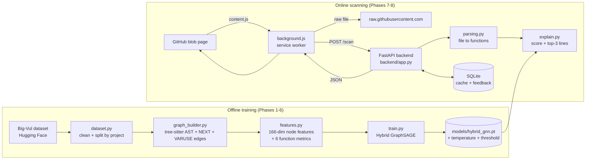

# GNN-Based Vulnerability Scanner for C/C++ on GitHub

A scanner that reads C/C++ code on GitHub, turns every function into a **graph**,
and uses a **Hybrid GraphSAGE** neural network (trained from scratch) to predict a
bug-risk score per function. It highlights the riskiest lines with a short
plain-English reason, right inside the GitHub page, through a Chrome extension.

> **Results in one line:** on a project-disjoint Big-Vul test set, the Hybrid
> GraphSAGE reaches **PR-AUC 0.208**, about **double** the best baseline (0.108). In
> its top-10% worklist, **1 in 5** functions is a real vulnerability, against 1 in 8
> for the best baseline.

---

## 1. Problem

Rule-based static analyzers (regex/pattern tools such as Flawfinder) **miss
structural bugs** and raise **many false alarms**. Machine-learning tools that
treat code as **plain text** throw away its **tree structure** and the **order in
which it runs**.

This project keeps that structure:

1. Split each source file into functions.
2. Turn each function into a graph: its **Abstract Syntax Tree (AST)** plus two
   simple extra edge types (statement order and variable reuse).
3. A **Hybrid GraphSAGE** GNN predicts a bug-risk probability per function.
   *Hybrid* means the learned graph embedding is concatenated with 6 hand-crafted
   code metrics before the final classifier.
4. Explain the score: rank lines by **attention × gradient saliency**, return the
   top 3 lines with a template reason.
5. Show it on GitHub through a Chrome extension talking to a local FastAPI server.

---

## 2. Architecture



**Inside the model** (`src/model.py`):

```
node features (166) ─► SAGEConv ─► SAGEConv ─► SAGEConv ─► node vectors h (128)
                        (each: ReLU + dropout 0.3)

h ─► attention pool (linear score → softmax → weighted sum) ┐
  └► mean pool ─────────────────────────────────────────────┤► graph embedding (256)
                                                            │
graph embedding ‖ 6 metrics (262) ─► MLP 128 ─► 64 ─► 1 ─► sigmoid / temperature
```

---

## 3. Folder structure

```
Project/
├── data/                 # raw + processed data, cached graphs (gitignored)
├── src/
│   ├── dataset.py          # Phase 1: download, clean, split by project
│   ├── evaluate.py         # shared metrics: P/R/F1, PR-AUC, P@Top-10%
│   ├── parsing.py          # tree-sitter: file → functions → AST
│   ├── graph_builder.py    # AST + extra edges → PyG Data
│   ├── build_graphs.py     # Phase 3 runner: cache all graphs
│   ├── features.py         # node features + function metrics
│   ├── prepare_features.py # Phase 4 runner: vocab, metric stats
│   ├── gnn_data.py         # loading graphs for training
│   ├── model.py            # Hybrid GraphSAGE
│   ├── train.py            # training, calibration, ablations
│   ├── explain.py          # importance → line scores → reasons
│   ├── cwe.py              # stretch goal: CWE classes + labels
│   └── train_cwe.py        # stretch goal: CWE-type head training/eval
├── baselines/
│   └── run_baselines.py    # Flawfinder, TF-IDF + LogReg, risky-API rule
├── backend/
│   ├── app.py              # FastAPI server (/scan, /feedback, /health)
│   └── sample.c            # small file for testing the API
├── extension/              # Chrome extension (Manifest V3, plain JS)
├── docs/                   # illustrated explainer PDF + its HTML source
│   ├── GNN_Vulnerability_Scanner_Explained.pdf
│   ├── project_explained.html   # edit this, then: python docs/build_pdf.py
│   └── build_pdf.py
├── models/                 # saved weights + vocab + metric stats (gitignored)
├── notebooks/              # optional EDA
├── requirements.txt
└── README.md
```

---

## 4. Setup

Needs **Python 3.10+** (built and tested on 3.13, Windows 11). Runs on a normal
laptop (CPU, 8-16 GB RAM); a GPU is optional.

```powershell
cd C:\path\to\Project
python -m venv .venv
.venv\Scripts\activate
pip install -r requirements.txt
```

A plain `pip install torch` gives the CPU build, which is enough for everything.

---

## 5. Reproduce the pipeline

Run these **from the project root**, in order. Each step caches its output, so you
only run it once.

| Step | Command | What it does | Time* |
|---|---|---|---|
| 1. Data | `python src/dataset.py --subset 30000` | Download Big-Vul, clean, split by project | ~1-3 min (first download) |
| 2. Baselines | `python baselines/run_baselines.py` | Score the 3 baselines on test | ~1 min |
| 3. Graphs | `python src/build_graphs.py` | Build + cache 30k graphs | ~15 s |
| 4. Features | `python src/prepare_features.py` | Type vocab, metric stats, metric vectors | ~30 s |
| 5. Train | `python src/train.py` | Main model + 3 ablations + final table | ~5 min GPU; longer on CPU |
| 6. Explain | `python src/explain.py` | Demo explanation + Top-3 line hit rate | ~30 s |

\* Rough times on the development laptop (the training run used its GPU at about
3-8 s per epoch). On a CPU-only or low-RAM machine, train
faster with fewer graphs: `python src/train.py --max-train 6000 --epochs 15`
(add `--skip-ablations` to train only the main model).

Useful quick checks:

```powershell
python src/graph_builder.py     # prints one tiny example graph to check by eye
python src/parsing.py           # splits a small sample file into functions
```

---

## 6. Run the scanner

### 6.1 Backend

From the **project root**:

```powershell
python -m uvicorn backend.app:app --port 8000
```

Wait for `Model loaded. Ready to scan on CPU.` and `Application startup complete`.
Test it:

```powershell
$code = [System.IO.File]::ReadAllText("backend/sample.c")
$body = @{ filename = "sample.c"; code = $code } | ConvertTo-Json
Invoke-RestMethod -Uri http://127.0.0.1:8000/scan -Method Post -Body $body -ContentType "application/json"
```

**API**

| Endpoint | Body | Returns |
|---|---|---|
| `POST /scan` | `{filename, code}` | `{file_hash, functions: [{name, start_line, end_line, risk_score, band, top_lines: [{line, reason, text}]}], scan_time_ms, cached}`. `top_lines` is ranked: index 0 is the most likely vulnerable line. |
| `POST /feedback` | `{file_hash, function_name, line, is_false_positive}` | `{status: "recorded"}` |
| `GET /health` | none | `{status, model_loaded}` |

Results are cached in `backend/cache.db` (SQLite), keyed by `SCANNER_VERSION` +
SHA-256 of the file, so the same file is never scanned twice.

### 6.2 Chrome extension

1. Open `chrome://extensions` and turn on **Developer mode**.
2. Click **Load unpacked** and select the `extension/` folder.
3. Open any C/C++ file on GitHub, for example
   `https://github.com/git/git/blob/master/usage.c`.

You will see:
- a **risk-% badge** at each function's first line (green / yellow / red by band),
- each function's **most likely vulnerable line** in strong red with an inline
  callout, e.g. `⚠ Likely vulnerable line · memcpy with a size not checked…`;
  its #2 and #3 suspicious lines get a lighter tint,
- a **hover card** on any marked line: which line it is, its rank, the reason,
  the function's risk, and a **👎 Not a bug** button (sent to `/feedback`),
- a collapsible **side panel** (bottom-right) that names the single **most likely
  vulnerable line in the file** with its code, then lists every function by risk
  with its suspicious lines; click a line to jump to it,
- a **popup** (toolbar icon) with the same top line and the 5 riskiest functions,
  also clickable.

### 6.3 Troubleshooting

| Symptom | Cause / fix |
|---|---|
| `ModuleNotFoundError: No module named 'backend'` | You started uvicorn inside `backend/`. Run it from the project root, or use `python -m uvicorn app:app --port 8000` inside `backend/`. |
| `[Errno 10048] ... only one usage of each socket address` | Another server already uses port 8000. Stop it first. |
| Banner: "Backend not reachable at http://127.0.0.1:8000" | Start the backend. The extension uses `127.0.0.1`, not `localhost`, because Chrome may send `localhost` to IPv6 `::1` while uvicorn only listens on IPv4. |
| Banner: "no functions found in this file" | Normal for files with only declarations/tables (e.g. `ctype.c`). |
| Code changes don't show up | Restart uvicorn (it doesn't auto-reload) and click ↻ on the extension card. Bump `SCANNER_VERSION` in `backend/app.py` when parsing/model code changes, so old cached results are ignored. |
| Highlights stop working after a GitHub redesign | Fix `getCodeCell()` in `extension/content.js`. It is the only function that depends on GitHub's HTML. |

---

## 7. Results

### 7.1 Dataset (Phase 1)

Big-Vul (`bstee615/bigvul` on Hugging Face): **217,007** functions →
**213,407** after the 3-500 line filter → **160,888** after whitespace-insensitive
de-duplication → class-balanced subset of **30,000**.

| Split | Functions | Vulnerable | Projects |
|---|---|---|---|
| train | 24,000 | 1,222 (5.1%) | 98 |
| val | 3,000 | 172 (5.7%) | 96 |
| test | 3,000 | 193 (6.4%) | 96 |

Splits are **project-disjoint** (no project appears in two splits). A greedy packer
assigns whole projects so function counts still come out at 80/10/10.

Top CWEs: CWE-119 (4,208), CWE-20 (3,193), CWE-399 (2,311), CWE-264 (1,989),
CWE-416 (1,502), CWE-200 (1,416), CWE-125 (1,219), CWE-189 (1,107), CWE-362 (979).

### 7.2 Graphs and features (Phases 3-4)

| Split | Avg nodes | Avg undirected edges | Build failures |
|---|---|---|---|
| train | 119.9 | 146.1 | 0 |
| val | 172.2 | 217.8 | 0 |
| test | 245.4 | 313.6 | 0 |

Node features: **166** = 101 (one-hot of top-100 AST types + "other") + 64 (hashed
token) + 1 (risky-API flag). Metric means, vulnerable vs safe (train):

| Metric | Vulnerable | Safe | Ratio |
|---|---|---|---|
| lines of code | 49.35 | 23.96 | 2.06× |
| cyclomatic complexity | 9.31 | 4.76 | 1.96× |
| pointer operations | 25.77 | 11.38 | 2.26× |
| risky API calls | 0.24 | 0.07 | 3.29× |
| max nesting depth | 2.27 | 1.71 | 1.33× |
| parameters | 2.15 | 1.70 | 1.27× |

### 7.3 Function-level detection (Phases 2 and 5, test set)

A random ranker scores PR-AUC ≈ 0.064 (the vulnerable rate).

| Model | Precision | Recall | F1 | PR-AUC | P@Top-10% |
|---|---|---|---|---|---|
| Flawfinder (level ≥ 2) | 0.116 | 0.254 | 0.159 | 0.083 | 0.023 |
| TF-IDF + Logistic Regression | 0.108 | 0.456 | 0.174 | 0.103 | 0.123 |
| Risky-API rule | 0.125 | 0.218 | 0.158 | 0.108 | 0.110 |
| **Hybrid GraphSAGE (main)** | **0.219** | 0.306 | **0.255** | **0.208** | **0.203** |
| Ablation: AST edges only | 0.203 | 0.425 | 0.275 | 0.228 | 0.223 |
| Ablation: no metrics (pure GNN) | 0.104 | 0.782 | 0.184 | 0.133 | 0.173 |
| Ablation: GCNConv instead of SAGEConv | 0.152 | 0.601 | 0.242 | 0.194 | 0.203 |

**How to read it**

- **GNN vs baselines:** the main model roughly doubles the best baseline's PR-AUC
  (0.208 vs 0.108) and P@Top-10% (0.203 vs 0.123).
- **The metrics matter most:** removing the 6 metrics drops PR-AUC from 0.208 to
  0.133. Without them the model flags almost everything (recall 0.78, precision
  0.10).
- **SAGE vs GCN:** SAGEConv is slightly better (0.208 vs 0.194).
- **Extra edges did not help here:** AST-only (0.228) slightly beat AST + NEXT +
  VARUSE (0.208). The name-matched variable-use edges are a noisy approximation of
  data flow. The gap is small and could be run-to-run noise.
- **Flawfinder ranks below random** at P@Top-10% (0.023): its severity levels have
  many ties, so it can flag but not prioritise.

Training settings: Adam (lr 1e-3), batch 64, BCE with `pos_weight` = #safe/#vuln
(18.6), early stopping on validation PR-AUC (patience 6). Main model: temperature
**T = 6.73**, F1-optimal threshold **0.55** (both fit on validation). Bands on the
calibrated probability: Low < 0.4, Medium 0.4-0.7, High > 0.7.

### 7.4 Line-level explanations (Phase 6)

Node importance = **attention weight × gradient-saliency magnitude**, summed per
source line. The top 3 lines are returned, ranked; the #1 line is what the
extension labels "Likely vulnerable line". Each comes with a template reason
(strcpy/strcat, memcpy, use-after-free, malloc without a NULL check, else
"unusual structure").

Two rules decide which nodes vote for a line:
- **Single-line nodes only.** Multi-line "container" nodes (the whole function, a
  `{ }` body) describe a block, not a line; otherwise all their importance lands on
  their first line, usually the signature.
- **Body lines only.** The signature (return type, name, parameters) is crowded
  with small nodes but is a declaration, not where a bug happens.

Then, **pattern first**: within the top 3, a line matching a known dangerous
pattern (strcpy, memcpy, malloc…) is listed before generic ones, keeping the
model's order otherwise.

Ground-truth fix lines come from diffing `func_before` against `func_after`. A
"hit" means a line the real fix changed is in our top lines. The method was
**chosen on the validation set** (Top-1 0.327, vs 0.144 for the first version),
then reported once on test:

| Line-scoring method (137 vulnerable test functions) | Top-1 | Top-3 |
|---|---|---|
| Random lines (expected value) | 0.086 | 0.192 |
| All nodes, start line (first version) | 0.109 | 0.343 |
| Single-line nodes | 0.161 | 0.328 |
| Single-line nodes + body only | 0.204 | 0.380 |
| **+ pattern first (used)** | **0.212** | **0.380** |

The single "most likely vulnerable line" is a real fix line **21% of the time,
about 2.5× random**. Most of the gain comes from the first two rules. "Pattern
first" changes about one function per split, so it is a readability choice, not a
measurable accuracy gain. The random rates are fairly high because these functions
average about 120 lines and many fixes touch several lines. 56 of the 193
vulnerable test functions were fixed only by *adding* lines (e.g. a missing NULL
check), so no original line changed and they cannot be scored.

### 7.5 Backend speed (Phase 7)

| File | Functions | Scan time | Cached repeat |
|---|---|---|---|
| `backend/sample.c` | 3 | 23.8 ms | 1.7 ms |
| `git/usage.c` (406 lines) | 33 | 188-363 ms | 1-2 ms |

Well under the 2-second target for a 500-line file, on CPU.

---

## 8. Limitations (stated honestly)

- **Variable-use edges match by name**, not real data-flow analysis. Two different
  variables with the same name in different scopes get linked. This is the likely
  reason the extra edges did not beat AST-only.
- **Function-level only:** no cross-function or cross-file bugs.
- **Noisy labels:** Big-Vul labels come from vulnerability-fixing commits, and a
  function touched by a fix is not always the vulnerable one.
- **Explanations show where the model looked, not proof of a bug.** The named
  "most likely vulnerable line" is a real fix line only about 21% of the time
  (Top-3: 38%). The signature line is excluded by design, so bugs that are fixed
  by changing the signature can't be pointed at.
- **Low confidence:** calibrated scores cluster around 0.45-0.55, so in practice
  almost every function lands in the "Medium" band. The ranking is useful; the
  absolute bands are not very discriminative.
- **No preprocessor:** tree-sitter parses code without expanding macros, so
  macro-heavy code (e.g. `NORETURN`) can produce odd parse trees.
- **Trained on a 30k subset** of Big-Vul to fit a laptop. Results come from one
  training run (no repeated seeds), so small differences are within noise.
- **C/C++ language choice is a heuristic** (C++ is picked when `::`, `template`, `class`
  etc. appear).
- **The extension depends on GitHub's HTML.** It is isolated in one function, but a
  GitHub redesign can still break highlighting.

---

## 9. Stretch goal tried: CWE-type head

A second output head guesses the weakness type of vulnerable functions: the 5
most common training CWEs (119, 20, 399, 264, 200) plus "Other". It shares the
graph embedding with the risk head (multi-task learning). Only vulnerable,
CWE-labelled functions train it (901 in train); safe and untyped ones are masked,
because in Big-Vul every function in a fixing commit inherits the commit's CWE.

```powershell
python src/cwe.py         # pick classes from train, attach labels to graphs
python src/train_cwe.py   # train + evaluate, saves models/hybrid_gnn_cwe.pt
```

Stage 1 trains both heads together, with early stopping on the risk task. Stage 2
freezes the GNN and trains only the CWE head on the graph embeddings. Stage 2 was
needed because the risk task peaked after one epoch, before the CWE head had
learned anything.

| Method (182 vulnerable test functions) | Accuracy | Macro-F1 |
|---|---|---|
| Majority class (always "Other") | **0.544** | 0.117 |
| TF-IDF + Logistic Regression | 0.280 | 0.118 |
| GNN CWE head, stage 1 (joint) | 0.544 | 0.117 |
| GNN CWE head, stage 2 (head-only) | 0.495 | **0.151** |

**Result: weak, reported as a negative finding.** The head separates CWE-119 from
"Other" somewhat (CWE-119 F1 0.25) and has the best macro-F1, but its accuracy is
below the constant "Other" guess, and it never predicts the other three classes
correctly. The text baseline fails too, so the main limits are the labels:
- they **drift** across projects and years (val/test are dominated by CWE-125 and
  CWE-190, which are rare in train; older CVEs used the broad CWE-119),
- there are only about 900 labelled training examples.

The predicted type is therefore **not shown in the extension**. The UI supports a
`cwe` field if a future model earns it.

Side note: the multi-task model's risk head scored PR-AUC 0.231 / P@Top-10% 0.230
(vs 0.208 / 0.203 single-task). That's one run each, so it isn't claimed as an
improvement, and the backend keeps the original model.

---

## 10. Future work

- A better CWE head: more labelled data, a coarser/updated type taxonomy.
- Scan only the changed functions on Pull Request "Files changed" pages.
- Export the model to ONNX for faster CPU inference.
- Retrain using the collected 👎 false-positive feedback.
- Proper scope-aware def-use edges instead of name matching.
- Repeat training over several seeds and report mean ± std.
- Relative bands (e.g. "top 10% of this repo") instead of fixed probability cut-offs.
